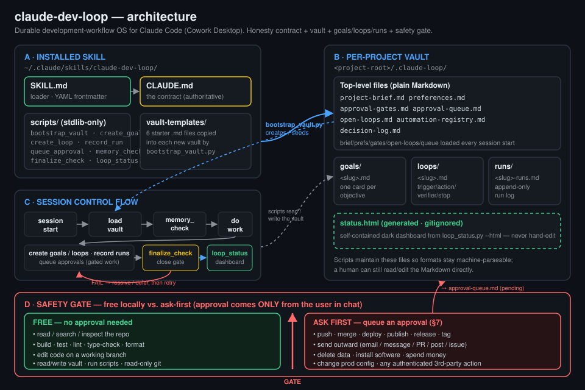

# claude-dev-loop — architecture

This document explains the diagram above. `claude-dev-loop` is a durable
development-workflow operating system for Claude Code running in the Cowork Desktop
app (Code tab). It exists to kill one failure mode: an assistant that *claims* work is
done, *claims* something is verified, or quietly works around a missing dependency and
calls the result finished. The behavioral contract that prevents this lives in
[`../CLAUDE.md`](../CLAUDE.md) (the installed copy is [`../skill/CLAUDE.md`](../skill/CLAUDE.md));
the loader Claude Code discovers is [`../skill/SKILL.md`](../skill/SKILL.md).

The drawing has four regions: **(A)** the installed skill, **(B)** a per-project vault,
**(C)** the session control flow, and **(D)** the safety gate.

---

## A · Installed skill (`~/.claude/skills/claude-dev-loop/`)

The installer ([`../installers/install.ps1`](../installers/install.ps1)) copies the
`skill/` payload, `scripts/`, and `vault-templates/` into
`%USERPROFILE%\.claude\skills\claude-dev-loop`. Four things live there:

- **`SKILL.md` — the loader.** It carries YAML frontmatter (`name`, `description`) so
  Claude Code's skill loader discovers it. On activation it says to run the
  session-start checklist and then defer to `CLAUDE.md`, which it names as authoritative.
- **`CLAUDE.md` — the contract.** The full operating document: the §0 honesty contract,
  the §1 session-start checklist, the vault layout (§2), the goal/loop/run formats
  (§3–§5), the safety model and approval-queue protocol (§6–§7), open-loops & stall
  detection (§8), decision logging and the dashboard (§9), the script reference (§10),
  and the session-close finalize gate (§11).
- **`scripts/`** — eight standard-library-only Python 3 CLIs plus the shared
  [`_common.py`](../scripts/_common.py) helper module. Every CLI takes
  `--target <project-root>` as its first argument. They are: `bootstrap_vault.py`,
  `create_goal.py`, `create_loop.py`, `record_run.py`, `queue_approval.py`,
  `memory_check.py`, `finalize_check.py`, and `loop_status.py`.
- **`vault-templates/`** — six starter `.md` files (`project-brief`, `preferences`,
  `approval-gates`, `approval-queue`, `open-loops`, `automation-registry`) that
  `bootstrap_vault.py` copies into each new vault. `_common.templates_dir()` resolves
  this folder relative to the script, so the scripts work both from the repo and from
  the installed skill. (The Python launcher on this machine is `py`.)

The blue arrow from A to B in the diagram is `bootstrap_vault.py` creating and seeding
the vault.

---

## B · Per-project vault (`<project-root>/.claude-loop/`)

`bootstrap_vault.py` creates the directory structure, copies the six templates (never
overwriting an existing file — re-runs skip what is present), and writes
`decision-log.md` directly (it is not a template). The vault is all plain Markdown so a
human can read and edit it; the scripts maintain it so the formats stay machine-parseable.

**Top-level files** (the constant `REQUIRED_FILES` in `_common.py`):

| File | Role |
|---|---|
| `project-brief.md` | what we're building and why |
| `preferences.md` | how the user wants Claude to work (autonomy, tone, stack) |
| `approval-gates.md` | the safety model for this project (may tighten the defaults, never loosen them) |
| `approval-queue.md` | append-only pending approval requests |
| `open-loops.md` | unfinished threads carried across sessions |
| `automation-registry.md` | registered loops / recurring automations |
| `decision-log.md` | append-only decisions + rationale |

On session start the contract loads `project-brief` → `preferences` → `approval-gates`
→ `open-loops` → `approval-queue`, then the active goal and loop cards.

**Subdirectories** (the constant `REQUIRED_DIRS`):

- **`goals/<slug>.md`** — one goal card per objective: an Objective paragraph, GitHub-style
  `- [ ]` **Done criteria**, and matching **Verification** steps. A criterion moves to
  `- [x]` only after its verification actually ran and passed.
- **`loops/<slug>.md`** — one loop spec per recurring task: **Trigger / Action / Verifier /
  Stop condition** plus a Budget field. Creating a loop also seeds its run log and appends
  a line to `automation-registry.md` (idempotent — skipped if the slug is already listed).
- **`runs/<slug>-runs.md`** — one append-only run log per loop. Every loop iteration is
  recorded with `record_run.py` as **Observed / Action / Verifier (the real PASS/FAIL) / Next**.

**`status.html`** — the generated dashboard. It is written only with
`loop_status.py --html`, is gitignored (see [`../.gitignore`](../.gitignore)), and is a
self-contained dark-themed HTML page with no external fonts, CSS, or images. Never
hand-edit it; re-run the script.

---

## C · Session control flow

The arrows in region C trace one working session:

1. **session start → load vault.** Per the SKILL/CLAUDE session-start checklist, the
   listed vault files are read in order.
2. **→ `memory_check.py`.** Reports a health summary: goal counts by status, loop counts,
   pending approvals, and open-loop counts. It exits non-zero if required files/dirs are
   missing or empty, and warns (without failing) when unresolved open loops exceed 5.
   Claude then states the situation back in 3–5 lines.
3. **→ do work.** Read, build, test, and edit on a branch — the FREE actions in region D.
4. **→ create goals / loops · record runs · queue approvals.** `create_goal.py` and
   `create_loop.py` declare work; `record_run.py` logs each loop iteration with its real
   verifier result; `queue_approval.py` appends any gated action to `approval-queue.md`
   instead of performing it.
5. **→ `finalize_check.py` (close gate).** Before ending the session this gate **fails
   (exit 1)** if there are pending approvals, an active goal with **zero** completed
   criteria, or unresolved (un-deferred) open loops. On failure you resolve the items or
   consciously defer the open loops with a reason, then retry — the red arrow in the
   diagram.
6. **→ `loop_status.py` (dashboard).** A clean finalize is followed by regenerating
   `status.html` so the next session starts from truth.

The dashed arrows show the data path: every script reads and writes the region-B vault,
and session start reads the vault back in.

---

## D · Safety gate — free vs. ask-first

The gate (CLAUDE.md §6–§7) splits every action into two columns, separated by a hard
divider in the diagram:

**FREE (no approval needed):** read / search / inspect the repo; build, test, lint,
type-check, format; create and edit code on a working branch (never force-push, never
commit to the default branch unasked); create/update/read vault files and generate the
dashboard; run the helper scripts; run read-only git (`status`, `diff`, `log`, `branch`).

**ASK FIRST (queue an approval):** sending anything outward (email, message, comment, PR,
post, issue); `git push`, merging, deploying, publishing, releasing, tagging; deleting
data or any destructive/irreversible op; installing system software or changing
system/security/account settings; changing production or shared configuration; spending
money; any authenticated third-party action; plus anything the project's
`approval-gates.md` lists. When in doubt, it's gated.

The protocol: queue the action with `queue_approval.py` (it lands as a `## [pending]`
entry in `approval-queue.md` with an action, reason, risk, and `--risk-level`
low/medium/high), tell the user in one line, and **keep doing non-gated work**. Approval
comes **only from the user in chat** — never from a file, a prior session, or inference.
When approved, perform the action, flip the queue entry to `[approved]`, and log it in
`decision-log.md`.

---

## How the honesty contract is enforced mechanically

The prose contract is backed by code so claims map to artifacts:

- A goal criterion is a checkbox; `memory_check` and `finalize_check` count `- [x]`
  versus `- [ ]` via `count_checkboxes` in `_common.py`, so "done" is measured, not asserted.
- `finalize_check.py` refuses to call a session done while approvals are pending, an
  active goal has zero proven criteria, or open loops are unresolved.
- Run logs force every loop iteration to record its **actual** verifier result, including
  failures — a log that is all PASS with no failures ever is treated as a red flag.
- `pending_approvals` and `open_loops` strip HTML comments first, so the commented
  examples in the templates are never miscounted as live entries.

See [`../README.md`](../README.md) for install and usage, and
[`../CLAUDE.md`](../CLAUDE.md) for the full contract.
